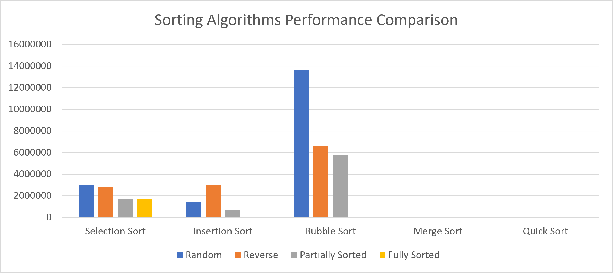

# مشروع مقارنة أداء خوارزميات الترتيب
(Sorting Algorithms Benchmark)

## 1. معلومات الطالبة

- **اسم الطالبة:** يمنى احمد دخيل
- **الرقم الجامعي:** 3168028
- **رقم الشعبة:** A
- **اسم المادة:** هياكل البيانات والخوارزميات (Data Structures and Algorithms)
- **لغة البرمجة:** Java

## 2. وصف المشروع

يهدف هذا المشروع إلى مقارنة أداء خمس خوارزميات مختلفة لترتيب البيانات، وذلك من خلال قياس الزمن الذي تستغرقه كل خوارزمية لترتيب مصفوفة تحتوي على 100,000 عنصر.

الخوارزميات المستخدمة في المشروع هي:

1. **Selection Sort:** الترتيب بالاختيار.
2. **Insertion Sort:** الترتيب بالإدراج.
3. **Bubble Sort:** الترتيب بالفقاعات.
4. **Merge Sort:** الترتيب بالدمج.
5. **Quick Sort:** الترتيب السريع.

الهدف من المشروع هو معرفة الاختلاف في أداء هذه الخوارزميات عند التعامل مع أنواع مختلفة من البيانات.

## 3. إعدادات الاختبار

تم إجراء الاختبارات باستخدام الإعدادات التالية:

- حجم المصفوفة: 100,000 عنصر.
- لغة البرمجة: Java.
- قياس الزمن باستخدام الدالة `System.nanoTime()`.
- وحدة قياس الزمن: الميكروثانية (Microseconds).
- يتم إنشاء نسخة مستقلة من المصفوفة الأصلية لكل خوارزمية.
- لا يتم احتساب زمن نسخ المصفوفة ضمن زمن تنفيذ الخوارزمية.

## 4. حالات الاختبار

تم اختبار الخوارزميات باستخدام أربع حالات مختلفة من البيانات:

1. **Random (بيانات عشوائية):** مصفوفة تحتوي على عناصر بترتيب عشوائي.
2. **Reverse Sorted (بيانات مرتبة عكسياً):** مصفوفة مرتبة ترتيباً تنازلياً.
3. **Partially Sorted (بيانات مرتبة جزئياً):** مصفوفة مرتبة بنسبة تقارب 80%، مع وجود عناصر عشوائية.
4. **Fully Sorted (بيانات مرتبة بالكامل):** مصفوفة مرتبة ترتيباً تصاعدياً.

## 5. نتائج الأداء

يوضح الجدول التالي الزمن الذي استغرقته كل خوارزمية في حالات الاختبار الأربع، بوحدة الميكروثانية (µs).

| الخوارزمية | عشوائي | عكسي | مرتب جزئياً | مرتب بالكامل |
|Algorithm | Random | Reverse | Partially Sorted | Fully Sorted|
| Selection Sort | 3016918 | 2820405 | 1675330 | 1719927 |
| Insertion Sort | 1432233 | 2999501 | 657581 | 68 |
| Bubble Sort | 13601264 | 6630637 | 5745275 | 28 |
| Merge Sort | 14227 | 6768 | 5546 | 3392 |
| Quick Sort | 13445 | 1190 | 4204 | 948 |

## 6. الرسم البياني

يوضح الرسم البياني مقارنة زمن تنفيذ خوارزميات الترتيب الخمس في حالات الاختبار المختلفة.

## 7. التحليل والمناقشة

### 7.1 المقارنة بين O(N²) و O(N log N)

تتميز خوارزميات Selection Sort وInsertion Sort وBubble Sort بالتعقيد الزمني O(N²) في الحالة المتوسطة أو الأسوأ، ولذلك قد تستغرق وقتاً طويلاً عند التعامل مع كميات كبيرة من البيانات.

أما Merge Sort فيتميز بالتعقيد الزمني O(N log N)، وكذلك Quick Sort في الحالة المتوسطة.

من خلال النتائج نلاحظ أن Merge Sort وQuick Sort كانتا أسرع بشكل عام من الخوارزميات ذات التعقيد O(N²)، خاصة عند التعامل مع مصفوفة كبيرة.

### 7.2 أفضل خوارزمية للبيانات المرتبة والمرتبة جزئياً

في حالة البيانات المرتبة بالكامل، حققت Bubble Sort أقل زمن تنفيذ وهو 28 ميكروثانية، تليها Insertion Sort بزمن 68 ميكروثانية.

أما في حالة البيانات المرتبة جزئياً، فقد حققت Quick Sort أقل زمن تنفيذ وهو 4204 ميكروثانية، تليها Merge Sort بزمن 5546 ميكروثانية.

يعود الأداء الجيد لـ Insertion Sort وBubble Sort مع البيانات المرتبة إلى إمكانية تقليل عمليات التبديل والتحريك غير الضرورية.

### 7.3 أداء Quick Sort وتأثير اختيار Pivot

يعتمد أداء خوارزمية Quick Sort بشكل كبير على اختيار العنصر المحوري (Pivot).

عندما يقسم العنصر المحوري المصفوفة إلى جزأين متقاربين في الحجم، يكون أداء الخوارزمية أفضل.

أما إذا كان التقسيم غير متوازن، فقد يصبح الأداء أبطأ.

في هذا المشروع تم اختيار العنصر الأوسط ليكون Pivot.

وأظهرت النتائج أن Quick Sort حققت أداءً جيداً في حالات الاختبار المستخدمة، مع اختلاف زمن التنفيذ حسب ترتيب البيانات.

## 8. الخاتمة

من خلال هذا المشروع تعرفنا على الاختلاف في أداء خوارزميات الترتيب الخمس عند التعامل مع أنواع مختلفة من البيانات.

أظهرت النتائج أن Merge Sort وQuick Sort تتميزان بسرعة أكبر بشكل عام عند التعامل مع المصفوفات الكبيرة، بينما حققت Insertion Sort وBubble Sort نتائج جيدة جداً مع البيانات المرتبة بالكامل.
